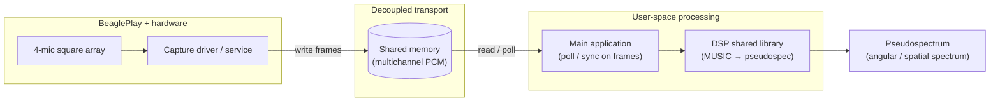

# rt_music

Real-time **MUSIC** (Multiple Signal Classification) direction finding in C++: estimate where a dominant source (for example human speech) is coming from, with a path from offline-capable DSP through embedded deployment on **BeaglePlay**.

---

## Vision and end-to-end architecture

The **target platform** is BeaglePlay with a **four-microphone array** laid out in a **square** (planar geometry). Audio is acquired in real time, handed off to processing without tight coupling between the capture path and the algorithm, and reduced to a **pseudospectrum** over candidate directions—the curve MUSIC uses to infer source bearings.

**Hardware capture path.** A dedicated **driver or capture service** talks to the microphones (I²S, TDM, or board-specific audio fabric), timestamps or sequences frames, and **writes multichannel PCM into shared memory** (for example a POSIX shared-memory segment or memory-mapped ring buffer). That layer is responsible for low-latency, continuous ingestion and for exposing a stable layout (four channels, frame alignment, sample rate).

**Main processing application.** A user-space **main app** does not drive the ADC directly; it **polls or blocks on the shared-memory buffer**, assembles short overlapping windows per channel, and calls into the **DSP library** to compute the **pseudospectrum** from the current covariance / subspace estimate. The app may also handle calibration, steering-vector lookup, and output (logging, network, or UI).

**DSP library role.** The heavy linear algebra and MUSIC-specific steps (spatial covariance, noise subspace, steering vectors, spectrum evaluation) live in a **shared library** so the same code can be unit-tested on a workstation, linked into the BeaglePlay image, and upgraded without re-flashing the capture driver.

Together: **microphones → driver → shared memory → main processor (poll) → DSP shared library → pseudospectrum.**



---

## Development roadmap

### Step 1 (current focus): DSP shared library — planar square 2×2 array

Before wiring the on-board capture stack, the first milestone is a **shared library** (DSP / “dsp-music” layer) that implements **pseudospectrum computation** for a **uniform planar square** microphone grid (**2×2**, four channels), with steering vectors precomputed for **azimuth in the array plane** (single-angle pseudospectrum). In this repository that corresponds to the **`MusicDsp`** shared target under `src/lib` (installed headers under `music-dsp`).

Repository layout today centers on this library with tests and precomputed steering data; integration with shared memory and the BeaglePlay driver comes after the library API and numerical behavior are solid.

### Later steps (toward the final stage)

- Extend steering / spectrum to **full 2D DOA** (azimuth and elevation or u–v) where a single-angle sweep is not enough.
- Implement or integrate the **shared-memory capture** contract and the **polling main app** on the target OS image (embedded image / BSP as needed).
- Tune frame sizes, sample rate, and real-time scheduling for stable latency on BeaglePlay.

---

## Description (concise)

The project implements a **real-time-capable** variant of the MUSIC algorithm, aimed at running on **BeaglePlay**, so the system can resolve **direction of a dominant source** (e.g. speech). The long-term picture is **four microphones on a square grid**, **driver-fed shared memory**, and a **main application** that consumes that stream and produces a **pseudospectrum** via a **shared DSP library**.

---

## Getting Started

### Catch2

```
cd ext/Catch2
cmake -B Build -S . -DBUILD_TESTING=OFF
sudo cmake --build Build/ --target install
```

### Precompute arrays

```
cd precompute_steering_vectors
./generate_steering_vectors.sh
```

### Build ut

```
mkdir ut/build && cd ut/build
cmake -GNinja ..
ninja && ctest -R ".*"
```

### Yocto image for BeaglePlay

The upstream layers are pinned as submodules under `yocto/` (all on the **scarthgap** branch). The project's own layer is [`yocto/meta-music`](yocto/meta-music). It provides `music-image`, which is `core-image-minimal` plus `music-dsp` (shared library from `src/lib`), `music-client` (from `src/client`), a dropbear SSH server, and the WL18xx Wi-Fi firmware and drivers.

#### 1. Host prerequisites (Ubuntu 24.04)

```
sudo apt install gawk wget git diffstat unzip texinfo gcc g++ build-essential chrpath socat \
    cpio python3 python3-pip python3-pexpect xz-utils debianutils iputils-ping python3-git \
    python3-jinja2 python3-subunit zstd liblz4-tool file locales libacl1 bmap-tools
sudo locale-gen en_US.UTF-8
```

Ubuntu 24.04 blocks unprivileged user namespaces, and BitBake needs them (otherwise it fails with *"User namespaces are not usable by BitBake"*):

```
echo 'kernel.apparmor_restrict_unprivileged_userns = 0' | sudo tee /etc/sysctl.d/60-bitbake-userns.conf
sudo sysctl --system
```

Plan on about 100 GB of free disk space and several hours for the first build.

#### 2. Fetch the layers

```
git submodule update --init --recursive
```

#### 3. Create the build directory and add layers

Run this from `yocto/`. It creates `yocto/build`, which is gitignored:

```
cd yocto
source poky/oe-init-build-env build      # cds into yocto/build
bitbake-layers add-layer ../meta-openembedded/meta-oe
bitbake-layers add-layer ../meta-arm/meta-arm-toolchain
bitbake-layers add-layer ../meta-arm/meta-arm
bitbake-layers add-layer ../meta-ti/meta-ti-bsp
bitbake-layers add-layer ../meta-music
bitbake-layers show-layers               # verify
```

`meta-oe` is required because both `music-dsp` and `music-client` depend on `libeigen`.

#### 4. Select the machine

Add this to `yocto/build/conf/local.conf`:

```
MACHINE = "beagleplay-ti"
```

The k3r5 multiconfig (the R5 bootloader core) is enabled automatically by the machine config, so you don't need to set `BBMULTICONFIG`. To use the BeagleBoard.org kernel instead of TI's, also add `../meta-ti/meta-beagle` and use `MACHINE = "beagleplay"`.

#### 5. Build

```
bitbake music-image
```

To rebuild only the app after changing code in `src/`:

```
bitbake -c cleansstate music-dsp music-client && bitbake music-image
```

#### 6. Flash an SD card

The output goes to `yocto/build/tmp/deploy/images/beagleplay-ti/`. Replace `/dev/sdX` with your SD card and double-check it with `lsblk` first:

```
cd tmp/deploy/images/beagleplay-ti
sudo bmaptool copy music-image-beagleplay-ti.rootfs.wic.xz /dev/sdX
```

Insert the card, then **hold the USR button while powering on** so BeaglePlay boots from SD instead of eMMC.

#### 7. Log in

- **Serial console:** UART header, `ttyS2`, 115200 baud.
- **SSH:** `ssh root@<board-ip>`. The image includes `debug-tweaks`, so root has an empty password. Development use only.
- **Wi-Fi:** configure `/etc/wpa_supplicant.conf`, then run `wpa_supplicant -B -i wlan0 -c /etc/wpa_supplicant.conf && udhcpc -i wlan0`.

#### Returning to an existing build

```
cd yocto && source poky/oe-init-build-env build && bitbake music-image
```
